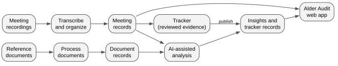

# Alder Audit: City Hall, Made Easier to Follow

Chicago's most important decisions start with conversations. Alder Audit helps
residents find those conversations, follow the issues they care about, and
see what was said in City Council meetings.

## From meetings to insight

Search meeting transcripts, explore an experimental policy dashboard, and look
up your ward using the City's service. Alder Audit also supports a tracker for
reviewed statements, commitments, and official actions, with links back to
source recordings. Reviewed meeting summaries and follow-ups can be published
as they become available.

## Built around the evidence

The tracker checks quotes against meeting transcripts, protects against
unconfirmed speaker attribution, and links readers to source recordings.
Reviewed evidence grounds tracker quotes and summaries. The experimental
dashboard uses AI to help surface patterns, not establish official positions.
Recordings provide the original context when transcripts contain errors.

## Designed to grow

Built for the SC26 CIQ Local AI Hackathon, Alder Audit uses CIQ Fuzzball to
distribute processing across two ThinkStation machines. This approach makes
it possible to work through more meetings while keeping the resulting
information easy to explore.

Our goal is a clearer picture of local government: concise meeting digests and
an evidence-linked view of commitments, grounded in the public record.

## Authors

Eliot Kmiec, Faye Xu, Everett Bogue, Michael Ho, and Sabrina Pena.

[Explore the project on GitHub](https://github.com/ek775/chi-ciq-26).
