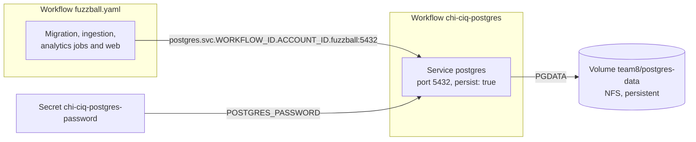

# Chicago meeting ingestion and web services

Container-oriented pipelines acquire public recordings, transcribe and diarize
them, and publish results to PostgreSQL/pgvector for a read-only web UI. The
Fuzzball deployment runs parallel ingestion and analytics pipelines, then starts
the final private web application after successful publication and backups.

## Architecture and module guides

```text
completed recordings -> 128 shards / 2 GPU workers -> meetings DB --+
transcript tree ------> 4 CPU document shards ------> documents DB -+
                                                                  |
                                            analytics sync -> roster
                                                                  |
              attribute | mentions | sentiment[32] | emotion[32] | topics
                       +------------------------------------------+
                       | attribute + topics -> stance[32] (8 requests) |
                       +-------------------- join ----------------+
                                             refresh -> analytics DB
                                                       |
                                  backups -> web checks -> private web
```

| Module | Responsibility and detailed documentation |
|---|---|
| [Pipelines](src/pipelines/README.md) | Container orchestration and Fuzzball handoff |
| [Downloads](src/pipelines/downloads/README.md) | Public Vimeo IDs, filename metadata, safe acquisition |
| [Transcription](src/pipelines/transcription/README.md) | Mounted-input batch ingestion, updates, inference API, GPU setup, tests |
| [Document pipeline](src/pipelines/documents/README.md) | Directory-tree ingestion, extraction, and text embeddings |
| [Analytics](src/pipelines/analytics/README.md) | Representative attribution, topic relevance, sentiment/emotion, vLLM stance |
| [Databases](src/databases/README.md) | Independent persistent database boundaries |
| [Meetings database](src/databases/meetings/README.md) | Schema, vectors, recording metadata, migrations, backups |
| [Documents database](src/databases/documents/README.md) | Per-directory pgvector tables, full text, migrations, backups |
| [Analytics database](src/databases/analytics/README.md) | Dashboard-oriented results, materialized views, reader role |
| [Web](src/web/README.md) | Transcript browsing/search, analytics dashboard API, access controls |
| [vLLM](src/vllm/README.md) | Upstream text-inference service used for stance analysis |

Each module guide lives beside its `__init__.py`. Custom service Dockerfiles
live in their source directories and use the repository root as build context.
PostgreSQL and vLLM use upstream images; web releases never replace live databases.

## Quick local start

Run these commands from the repository root:

1. Copy [.env.example](.env.example) to `.env`, set a Hugging Face read token,
   and set separate passwords for the admin and web database logins, including
   the analytics owner and dashboard reader (the `web` profile starts the
   analytics database). Use URL-safe passwords.
2. Accept the
   [pyannote model conditions](https://huggingface.co/pyannote/speaker-diarization-community-1).
3. Put complete, dated MP4s in `data/mp4/`, or run the downloads command below.
   Credentials and data are gitignored.

```sh
docker compose up -d db
# Optional acquisition; requires Vimeo/CDN network access:
docker compose --profile downloads run --build --rm downloads

docker compose --profile pipelines run --build --rm meetings-backup
docker compose --profile pipelines run --build --rm meetings-migrate
docker compose --profile pipelines run --build --rm transcription
docker compose --profile pipelines run --build --rm meetings-backup
docker compose --profile web up --build -d web
```

Open **http://127.0.0.1:8080/**. Select jobs explicitly: acquisition, migration,
transcription, and backup are ordered operations, not simultaneous batch services.
NVIDIA Docker support is required for the current transcription configuration.
First builds and model downloads need network access and can take time.
Vimeo titles lacking meeting date/type require an explicit metadata mapping;
see the [downloads guide](src/pipelines/downloads/README.md).

Unchanged transcription inputs are skipped. Changed inputs replace the previous
published run only after successful processing; failures preserve published
results. Backups are append-only. See the [update contract](src/pipelines/transcription/README.md#ingestion-versus-updates).

## Documents to database

The independent documents container mirrors directories as chunk tables and
preserves each file's full extracted text and relative path. TXT/Markdown, PDF,
DOCX, and HTML are supported with local embeddings shared with transcription.
Set `DOCUMENTS_POSTGRES_PASSWORD` and `DOCUMENTS_INPUT_DIR` in `.env`
(default input: `data-reference`).

```sh
docker compose --profile documents up -d documents-db
docker compose --profile documents run --build --rm documents-backup
docker compose --profile documents run --build --rm documents-migrate
docker compose --profile documents run --build --rm documents
docker compose --profile documents run --build --rm documents-backup
```

CPU inference is the default. Re-running skips unchanged files and atomically
replaces updated files; removed files are retained. See the
[document pipeline guide](src/pipelines/documents/README.md) for extraction
limits, settings, and the [database guide](src/databases/documents/README.md)
for table mappings and vector search.

## Analytics dashboard

The analytics batch reads the meetings and documents databases read-only and
writes to a third database designed for the dashboard at
**http://127.0.0.1:8080/dashboard**. It attributes speakers to city
representatives, scores policy-topic relevance with pgvector, predicts
sentiment and emotion locally, and asks vLLM for schema-constrained stances.
Each run builds the representative roster automatically: all 50 alderpersons
come from the City of Chicago Data Portal (the mayor and clerk, and an offline
fallback, from a bundled snapshot), and misspellings found in transcripts
("Alderman Riley") become aliases. Optionally put corrections in `roster.csv`
and labels in `speaker-labels.csv` under `data/analytics/`; see the
[analytics guide](src/pipelines/analytics/README.md) for formats.

```sh
docker compose --profile web run --rm meetings-web-role
docker compose --profile ai up -d vllm
docker compose --profile analytics run --build --rm analytics-backup
docker compose --profile analytics run --build --rm analytics-web-role
docker compose --profile analytics run --build --rm analytics \
  chi-ciq-analytics roster /inputs/roster.csv
docker compose --profile analytics run --build --rm analytics \
  chi-ciq-analytics label-speakers /inputs/speaker-labels.csv
docker compose --profile documents up -d db documents-db
docker compose --profile analytics run --build --rm analytics
docker compose --profile analytics run --build --rm analytics-backup
```

Append `chi-ciq-analytics run --sources meetings` to the analytics job when the
documents database is not running. The job reads meetings as `web_reader`. Voice-based attributions are inferred, not verified; the dashboard
shows each attribution method and confidence. Stances default to
`zai-org/GLM-5.3-Flash`, which needs about 306 GiB of GPU memory (for example
8× H100/H200); see [vLLM](src/vllm/README.md) for smaller alternatives.

## Quick ingestion commands

```sh
# Process the current recordings batch using the transcription container:
docker compose --profile pipelines run --build --rm transcription \
  chi-ciq-ingest --input-dir /inputs --namespace recordings

# Optional per-recording fan-out for larger inputs:
chi-ciq-dispatch --input-dir data/mp4 --output-dir data/dispatch \
  --image docker://your-registry/chi-ciq-transcription:commit-tag
```

## Fuzzball deployment

[fuzzball.yaml](fuzzball.yaml) is an executable v4 deployment Fuzzfile, validated
with CLI v4.3.1. It uses the existing persistent volumes `shared/datasets` and
`team8/volume_test`. PostgreSQL databases and the private vLLM service are
managed outside this workflow; deploying the web image never replaces them.
PostgreSQL runs in its own workflow: see [PostgreSQL service](#postgresql-service).

The workflow backs up and migrates each database independently, queues 128
transcription shards with two active one-GPU tasks alongside four CPU document
tasks, then joins both
ingestion arrays before analytics sync and roster preparation. Attribution,
mentions, sentiment, emotion, and topics run in parallel. Sentiment and emotion
each use 32 shards with four active CPU tasks. Stance waits for topics
and attribution and uses 32 shards with four active tasks, each sending at most
two vLLM requests (eight across the array). Dashboard
refresh waits for every analysis branch. Completed backups and reader/schema
checks gate the persistent web service. Failed jobs prevent dependent deployment.

### PostgreSQL service

[fuzzball-postgres.yaml](fuzzball-postgres.yaml) is a separate workflow with one
long-running service: PostgreSQL 17 with pgvector (`pgvector/pgvector:pg17`,
arm64). Its data directory is on the persistent NFS volume `team8/postgres-data`,
so the databases survive a stop, a failure, or a move to a different node.

```sh
# Start (the service runs until you stop the workflow):
fuzzball workflow start fuzzball-postgres.yaml --name chi-ciq-postgres
# Find the node the service runs on (the `Host` of the postgres stage):
fuzzball workflow describe <workflow-id>
# Stop. PostgreSQL shuts down cleanly and the data stays on the volume:
fuzzball workflow stop <workflow-id>
```



Other workflows connect as user `postgres` to
`postgres.svc.<workflow-id>.<account-id>.fuzzball:5432`, or to the node address
on port 5432. Connections from other hosts must give the password
(`scram-sha-256`). **The workflow ID and the node change on each start**, so
update the `*-url` secrets below after you start the service again.
The password applies only when the data directory is first initialized; a
later change to the secret does not change the password of an existing database.
Do not start a second copy of this workflow while one runs: two servers must
not share one data directory.

One-time setup (already done on the hackathon cluster):

```sh
fuzzball volume create team8 postgres-data
# password.json contains {"type": "value", "secret": {"value": "<password>"}}
fuzzball secret create secret://user/chi-ciq-postgres-password password.json --from-file
```

### Build and publish

The [Build and publish Fuzzball images workflow](.github/workflows/build-publish-images.yml)
builds the seven service images on a native ARM64 GitHub-hosted runner and
publishes them to GHCR. It runs on relevant pushes to `main` or can be started
manually from the Actions tab. Each image gets a `sha-<commit>` tag; builds on
the default branch also update the `fuzzball` tag used by this Fuzzfile.
For an immutable deployment, replace the `fuzzball` tag in all seven image
definitions with that build's full `sha-<commit>` tag.

Make the images readable by cluster workers, or add a singular `image.secret`
registry reference to each image definition (the anchored definitions cover
repeated uses). Rebuild the workers for this release: older images do not
support the new sharding and parallel-stage flags.
The images are ARM64; the workflow does not verify GPU runtime support. Before
a GPU release, check that the transcription image's ARM64 PyTorch build is
CUDA-enabled and supports the installed GPU/driver. Run
`python -c 'import torch; assert torch.cuda.is_available()'` inside that image
on a GPU worker before bulk submission.

### Inputs and credentials

Before submission, finish acquisition and freeze the input tree for the entire
ingestion run. Worker paths are not submitter-local paths:

| Volume | Required paths |
|---|---|
| `team8/volume_test` mounted at `/volume` | Complete MP4 files directly under `/volume/audio` |
| `shared/datasets` mounted at `/datasets` | `/datasets/Transcripts`, reviewed `/datasets/analytics/recording-metadata.json`, writable `/datasets/database` |

The metadata JSON maps Vimeo IDs to dated filenames; use `{}` if all recordings
already have valid dated names. See the
[transcription guide](src/pipelines/transcription/README.md#fuzzball-batch-input).
Optional `roster.csv` and `speaker-labels.csv` under `/datasets/analytics` are
loaded after source sync and roster seeding. VTT and database archives are never
ingestion inputs. The workers only read inputs; Fuzzball volume mounts themselves
are not asserted to enforce read-only access. Apply cluster filesystem ACLs to
protect the input trees while allowing archive jobs to write the backup subtree.
The NFS backend must support POSIX locking and atomic rename for backups.

Create these **user-scoped value secrets**; their values are never stored in the
Fuzzfile. URLs must use cluster-reachable hostnames, not submitter `localhost`.

| Secret name (prefix `chi-ciq-`) | Value / privileges |
|---|---|
| `meetings-writer-url` | SQLAlchemy PostgreSQL URL for the meetings owner |
| `documents-writer-url` | SQLAlchemy PostgreSQL URL for the documents owner |
| `analytics-writer-url` | SQLAlchemy PostgreSQL URL for the analytics owner |
| `meetings-reader-url` | Meetings SELECT-only login, also used by web |
| `documents-reader-url` | Documents SELECT-only login, including directory chunk tables |
| `analytics-reader-url` | Dashboard `analytics_reader` login |
| `hf-token` | Hugging Face read token with accepted pyannote model terms |
| `vllm-url` | Private OpenAI-compatible base URL ending in `/v1` |
| `vllm-api-key` | vLLM bearer key (empty value only if the private server has no authentication) |
| `vllm-served-model`, `vllm-reasoning-effort`, `vllm-reasoning-tokens`, `log-level` | Settings read from the submitter's `.env` |

Use the installed helper to pipe your `.env` variables into these secrets:

```sh
python -m pip install -e ".[deployment]"
chi-ciq-fuzzball-env --env-file .env --check
chi-ciq-fuzzball-env --env-file .env
fuzzball workflow validate data/deployment/fuzzball.yaml
fuzzball workflow start data/deployment/fuzzball.yaml --name chi-ciq-web-release
# Sync a subset without requiring the full deployment configuration:
chi-ciq-fuzzball-env --env-file .env --only HF_TOKEN LOG_LEVEL
```

The helper parses dotenv without executing shell code or interpolating variables.
It validates the selected values before making any changes, creates missing
user-scoped value secrets, and updates existing ones. Values travel on stdin,
not command-line arguments, output, or generated workflow files. A failed CLI
call stops synchronization; earlier successful uploads are not rolled back.
`--check` is entirely local. Use `--fuzzball` or `FUZZBALL_BIN` to select the CLI.
The helper writes a gitignored configured Fuzzfile at
`data/deployment/fuzzball.yaml` (`--output` overrides it). Submit this file when
using dotenv: Fuzzball rejects empty value secrets and empty environment entries,
so deliberately empty API keys/reasoning effort are exported inside worker scripts
instead of secret references. All nonempty credentials remain secret references.

Database mappings are `DATABASE_URL` (meetings writer),
`DOCUMENTS_DATABASE_URL`, `ANALYTICS_DATABASE_URL`, `MEETINGS_DATABASE_URL`
(meetings reader), `DOCUMENTS_READER_DATABASE_URL`, and
`ANALYTICS_READER_DATABASE_URL`. Reader URLs must be supplied separately; the
helper never reuses owner credentials for web access or invents database hosts
from `POSTGRES_PASSWORD`. Loopback URLs are rejected because they refer to the
worker, not your submitter. Set cluster-reachable URLs in your private `.env`.
Local input directories and unrelated variables are not forwarded.
`LOG_LEVEL`, `VLLM_SERVED_MODEL`, `VLLM_REASONING_EFFORT`,
`VLLM_REASONING_TOKENS`, and `VLLM_API_KEY` use the application defaults when
absent. Empty reasoning effort/API key are preserved deliberately.

Provision reader roles first using the
[meetings grants](src/web/web-role.sql) and
[analytics grants](src/databases/analytics/web-role.sql), after the corresponding
schemas exist; the workflow's `web-check` verifies SELECT privileges before
launching the web service. Give the documents reader SELECT on the registry
and chunk tables, including owner default privileges for newly created tables.
Existing schema migrations re-grant dashboard views when rebuilding them.

Set `VLLM_SERVED_MODEL` in `.env` to the deployed
model's served name (default `local-ai`). Workers need model-download egress,
City of Chicago roster access, and private database/vLLM connectivity.
### Two-workstation capacity

The profile targets two 20-core, 128 GB workstations with one GPU each; it does
not assume GPU slicing or oversubscription.

| Work | Total shards | Active tasks | Per-task CPU / memory |
|---|---:|---:|---|
| Transcription | 128 | 2 | 8 cores / 64 GiB / 1 GPU |
| Documents | 4 | 4 | 4 cores / 8 GiB |
| Sentiment | 32 | 4 | 2 cores / 8 GiB |
| Emotion | 32 | 4 | 2 cores / 8 GiB |
| Stance client | 32 | 4 | 1 core / 2 GiB |

Transcription plus documents request 32 CPU cores and 160 GiB in aggregate.
Analytics inference branches conservatively total 32 cores and 96 GiB, even
counting topics and stance together (they actually have an ordering dependency).
BLAS/OpenMP threads are capped at two per analytics task to prevent each process
using every CPU. These are scheduling requests, not measured peak usage; reserve
additional capacity for the OS, unified GPU memory, databases, and inference
services. vLLM remains external and its memory is **not** included in this budget;
if it shares these two workstations, lower worker concurrency accordingly.

Shard count controls queued work and straggler/retry granularity, not the number
of simultaneous GPU workers. 128 shards keep two GPUs fed with smaller batches
instead of two long-lived halves of the corpus. More shards also mean more model
startup overhead, so tune the count from recording runtimes and model-load cost.
Do not raise transcription concurrency above available whole GPUs without a
separately configured and tested GPU-sharing mechanism.

When changing transcription counts, keep `start: 1`, `end`, and `SHARD_COUNT`
consistent. For analytics, match `end` and the script's `--shard-count`; analytics
supports up to 256 shards and assigns each unit to exactly one shard.
`concurrency` may be lower than the shard count. Stance request concurrency is
the product of active tasks and `--stance-concurrency`; tune it to the actual
vLLM capacity, not just client RAM. `--stance-limit` is per shard when sharded.
Source sync, roster, attribution, mentions, topic rebuilding, and dashboard
refresh remain unsharded to protect their global-state operations.

### Submit and verify

```sh
fuzzball workflow validate fuzzball.yaml
fuzzball workflow start fuzzball.yaml --name chi-ciq-web-release
# Use the returned workflow ID:
fuzzball workflow describe WORKFLOW
fuzzball workflow endpoints WORKFLOW web app
fuzzball workflow port-forward WORKFLOW web 8080:8080
# In another terminal while forwarding:
curl --fail http://127.0.0.1:8080/ready
curl --fail http://127.0.0.1:8080/api/analytics/summary
```

The web endpoint is **user-scoped**, not public. Use Fuzzball endpoint bearer
tokens or authenticated port forwarding; neither the application nor vLLM adds
application authentication. `persist: true` keeps web running after batch jobs
finish. `/ready` verifies both configured schemas. The UI is at `/`, and the
final analytics dashboard is at `/dashboard`.

For updates, freeze the next input snapshot and submit a new release with the
same source namespaces. Do not overlap whole update workflows: the analytics
locks protect individual runs, not a cross-workflow ingestion-to-refresh epoch.
Verify the new endpoint before retiring the old web workflow; retain databases,
inputs, and append-only archives. Scheduling is external, not a polling daemon.
Schema validation alone does not verify image availability, secret values,
input completeness, GPU capacity, inference accuracy, or live endpoint readiness.

## Logging

No logging server, extra container, or shared worker filesystem is needed.
From your logged-in **Fuzzball submitter**, collect a job's logs locally:

```sh
fuzzball workflow describe WORKFLOW
bash scripts/logs.sh WORKFLOW JOB
# In another terminal (substitute the actual workflow ID and job name):
tail -f data/logs/WORKFLOW/JOB.log
grep '"level": "ERROR"' data/logs/WORKFLOW/JOB.log
```

The helper runs `fuzzball workflow log WORKFLOW JOB --follow` and appends to
gitignored `data/logs/WORKFLOW/JOB.log`, while also showing output in the terminal.
Run it for each container/job you want to collect: downloads, transcription
workers, migrations, backups, web, PostgreSQL, and vLLM, using the job names in
your cluster template. Workflow IDs are in the dispatch CLI receipts; job names
are the **template's job keys**, not necessarily the dispatch workflow name.
Collection is explicit, not automatic discovery of every submitted workflow.
Run several collectors in separate terminals; they write separate files.

```sh
# Download retained logs and exit, including completed/failed jobs:
bash scripts/logs.sh WORKFLOW JOB --lines -1
# Follow only new output, without re-appending history:
bash scripts/logs.sh WORKFLOW JOB --follow --lines 0
# Inspect all collected jobs together:
tail -f data/logs/*/*.log
```

Set `LOG_DIR` to change the host directory, or `FUZZBALL_BIN` to select the CLI.
Ctrl-C stops collection, not the remote job. CLI failures remain visible and
return a nonzero exit code. Re-running collection with history enabled appends
duplicates; there is no automatic reconnect, deduplication, or rotation.
Archive the directory between hackathon runs. Fetch logs before deleting
workflows or the cluster's log retention expires.

Python services use shared JSON logging on stderr: UTC `timestamp`, `level`,
`service`, `logger`, `message`, and `exception` when present. Uvicorn access/error
logs and Python warnings use the same format. Set `LOG_LEVEL` (default `INFO`)
and optionally `LOG_SERVICE_NAME` in each Fuzzball job's environment.
Machine-readable CLI results remain on stdout. PostgreSQL, vLLM, subprocesses,
and CLI output keep their native format, so collected files are mixed text,
not guaranteed JSONL. Add `--timestamp` to collection for server timestamps on
native output. Keep logs private: URLs, paths, and exception details may be sensitive.

The Fuzzball CLI flags above were checked locally; a live application release
still requires the images, credentials, and inputs above. For Compose development, use
`docker compose --profile '*' logs --follow --timestamps --no-color`;
this does not collect remote Fuzzball jobs.

## Development and quick checks

```sh
docker compose up --build -d app
docker compose exec app sh -c \
  'TEST_DATABASE_URL="$DATABASE_URL" python -m pytest -q'
```

For host development, use Python 3.12+, install FFmpeg and the needed extras:

```sh
python -m pip install -e ".[dev,ingestion,web,downloads,documents,analytics]"
python -m pytest -q
python -m ruff check src tests
```

Without `TEST_DATABASE_URL`, PostgreSQL integration tests skip. Tests use model
stand-ins; they do not measure recognition accuracy or verify Fuzzball scheduling.
GPU requirements, library API usage, streaming behavior, and validation details
are in the [transcription guide](src/pipelines/transcription/README.md).

The development web/API and vLLM services have no application authentication.
Keep them private; review their module guides before exposing them. Dependencies
are not locked for production.
