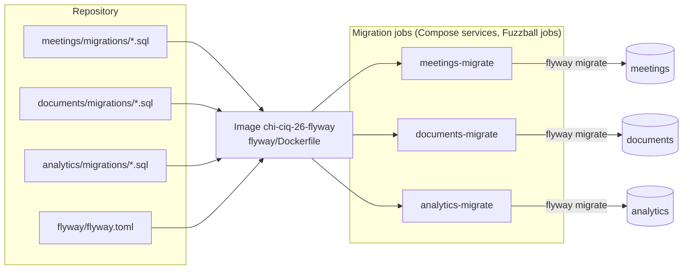

# Database containers

[Project overview](../../README.md) | [Meetings](meetings/README.md) |
[Documents](documents/README.md) | [Analytics](analytics/README.md)

## Schema migrations (Flyway)

[Flyway](https://documentation.red-gate.com/flyway) manages the schema of the
three databases. Run shell examples from the repository root.

```sh
# Apply the pending migrations to a local Compose database:
docker compose --profile pipelines run --build --rm meetings-migrate
docker compose --profile documents run --build --rm documents-migrate
docker compose --profile analytics run --build --rm analytics-migrate
# Show which migrations a database has (any Flyway command can replace `migrate`):
docker compose --profile pipelines run --build --rm meetings-migrate info
```

On Fuzzball, the jobs `meetings-migrate`, `documents-migrate` and
`analytics-migrate` of [fuzzball.yaml](../../fuzzball.yaml) do the same.



- **Where the SQL is:** `src/databases/<name>/migrations/`. The image built from
  [flyway/Dockerfile](flyway/Dockerfile) carries each directory at
  `/flyway/sql/<name>`. Each job selects its directory with `FLYWAY_LOCATIONS`
  and its database with `FLYWAY_URL`, `FLYWAY_USER` and `FLYWAY_PASSWORD`.
- **To change a schema:** add a file `V<next number>__<description>.sql` to the
  directory of that database, and make the same change in the SQLAlchemy model.
  Do not edit a versioned file that a database already has: Flyway compares
  checksums and stops.
- **Dashboard views:** `analytics/migrations/R__dashboard_views.sql` is a
  repeatable migration. Edit it in place; Flyway applies it again when its
  content changes.
- **Databases from before Flyway:** [flyway/flyway.toml](flyway/flyway.toml)
  sets `baselineOnMigrate` with version 0. Flyway records such a database at
  version 0 and then applies `V1__baseline.sql`, in which every statement is
  idempotent.
- **Not managed by Flyway:** the per-directory `doc_*` chunk tables, which the
  documents pipeline creates when it finds a directory.
- **Tests:** the integration tests apply the same SQL files with
  `tests/flyway_migrations.py`, so they do not need Java. `check` commands
  compare the database with the SQLAlchemy models.

Database lifetimes are independent of finite ingestion jobs and replaceable web
deployments. Each database needs its own persistent storage, connection secret,
and backup destination. Never mount one PostgreSQL data directory in concurrent
server containers.

- [Meetings](meetings/README.md): implemented PostgreSQL/pgvector schema and
  maintenance commands. The server uses the upstream `pgvector/pgvector:pg17`
  image; the module Dockerfile builds check/backup jobs, not the server.
- [Documents](documents/README.md): implemented PostgreSQL/pgvector registry and
  per-directory chunk tables, with independent check/backup jobs.
  The `documents` Compose profile uses separate storage and credentials.
- [Analytics](analytics/README.md): derived, dashboard-oriented results written
  only by the analytics pipeline. Its `analytics_reader` role can select the
  dashboard views but not voice centroids, embeddings, or labeling notes.

Run backup before migration and after successful ingestion. Never restore with
`--clean` into the live database; restore into a new empty database. Detailed
commands and safety contracts belong in the [meetings guide](meetings/README.md).
